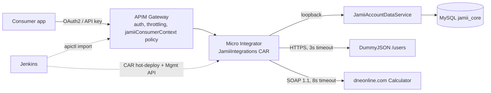

# Jamii Savings - WSO2 Integrations

Three integrations for the fictional bank **Jamii Savings**, built on **WSO2 Micro Integrator 4.4**, exposed and governed through **WSO2 API Manager 4.4**, and shipped by **one Jenkins pipeline**.

| # | Operation | Backend | Pattern |
|---|---|---|---|
| 1a | `GET /accounts/{accountNumber}/balance` | MySQL via MI data service | DB-backed API, fixed response envelope |
| 1b | `GET /customers/{customerId}` | [DummyJSON](https://dummyjson.com) `/users/{id}` | Managed proxy |
| 1c | `POST /loans/eligibility` | DNE Online Calculator (SOAP 1.1) | REST/JSON -> SOAP -> JSON |
| Bonus A | `GET /customers/{customerId}/dashboard` | DummyJSON + MySQL, in parallel | Scatter-gather, partial results |



---

## Repository layout

```
mi/JamiiIntegrations/           MI integration project (MI 4.4 layout) -> one CAR
  src/main/wso2mi/artifacts/
    apis/                       JamiiAccountBalanceAPI, JamiiCustomerAPI (+dashboard), JamiiLoanEligibilityAPI
    data-services/              JamiiAccountDataService.dbs (parameterised queries)
    endpoints/                  timeouts, suspension, env-injected URLs
    sequences/                  shared: Init, LogBackendCall/Response, ErrorResponse, SendResponse, FaultHandler, dashboard
    local-entries/              LoanEligibilityRequestSchema (JSON Schema)
db/                             01-schema.sql, 02-seed.sql (auto-loaded by the MySQL container)
apim/
  apis.manifest                 the list of APIs the pipeline builds/deploys
  apis/<Api>-1.0.0/             apictl projects: api.yaml, Definitions/swagger.yaml, api_params.yaml (dev/prod), Policies/
  api-products/JamiiCoreBanking-1.0.0/
docker/                         docker-compose (MySQL + MI + APIM), MI image (JDBC driver, public CA trust)
deploy/environments/            dev.env (wired), prod.env (conceptual)
scripts/                        build-mi, package-apim, deploy (all-or-nothing), smoke-test, devportal-onboard, ...
tests/                          pytest suite + real captured backend fixtures + deploy rollback simulation
Jenkinsfile
```

## Quick start

```bash
scripts/run-tests.sh                 # offline tests (~1 s)
scripts/build-mi.sh                  # -> dist/mi/JamiiIntegrations_1.0.0.car
scripts/package-apim.sh              # -> dist/apim/*.zip
scripts/env-up.sh                    # MySQL + MI + APIM via docker compose (first start ~3-5 min)
scripts/install-apictl.sh && export PATH="$PWD/.tools/apictl:$PATH"
scripts/deploy.sh dev                # MI + 3 APIs + product, smoke-tested, rolls back on failure

curl -s localhost:8290/accounts/1000000001/balance | jq     # direct to MI (dev only)
eval "$(scripts/devportal-onboard.sh dev MyApp)"              # get a token + API key like a consumer would
curl -sk -H "Authorization: Bearer $ACCESS_TOKEN" https://localhost:8243/jamii/accounts/1.0.0/1000000001/balance | jq
curl -sk -H "apikey: $API_KEY" -H 'Content-Type: application/json' \
  -d '{"customerId":"1","monthlyIncome":120000,"existingMonthlyDebt":15000,"requestedAmount":300000,"termMonths":24}' \
  https://localhost:8243/jamii/loans/1.0.0/eligibility | jq
```

**Live walkthrough:** `scripts/demo.sh` makes each call through the APIM gateway as an onboarded consumer would (Enter to advance; `DEMO_AUTO=1` runs on a timer).

Seed accounts: `1000000001`-`1000000007` (ACTIVE, DORMANT, CLOSED, a USD account). Customer IDs 1-5 own accounts; IDs map onto DummyJSON users.

---

## Part 1 - Micro Integrator services

### Conventions shared by all three APIs

Every resource runs the same three shared sequences, so behaviour is identical regardless of backend:

* **`Jamii_InitRequest`** - generates `requestId` (UUID) and an ISO-8601 `timestamp`; accepts the caller's `X-Correlation-ID` only if it matches `^[A-Za-z0-9._:-]{8,64}$` (otherwise mints one - blocks header injection / log forging); masks the business identifier for logs; strips headers that must never reach a backend (`Authorization`, `Cookie`, `apikey`, `X-JWT-Assertion`, `X-Internal-*`, `X-Forwarded-For`); logs `REQUEST_IN`.
* **`Jamii_ErrorResponse`** - the *single* error envelope, used for DB, HTTP and SOAP failures alike:
  ```json
  {"error":{"code":"ACCOUNT_NOT_FOUND","message":"No account exists for the supplied account number.",
            "status":404,"requestId":"3f0c8f0e-...","timestamp":"2026-10-13T08:15:30.123Z"}}
  ```
  `details` is added only for schema-validation failures, after stripping quotes/backslashes/control characters.
* **`Jamii_SendResponse`** - the only place that responds. It **resets response headers to an allow-list** (`X-Request-ID`, `X-Correlation-ID`, `Cache-Control: no-store`) so backend headers (`Server`, `Set-Cookie`, CDN headers) never leak and request headers are never echoed on locally generated replies; logs `RESPONSE_OUT` with status and duration.
* **`Jamii_FaultHandler`** - the fault sequence of every resource. Maps Synapse error codes (timeout -> 504, connection/suspended -> 503, anything else -> 500) and context (`jamii.stage=VALIDATION` -> 400; DB backend -> 503 `DATABASE_UNAVAILABLE`). The raw `ERROR_MESSAGE` is logged (truncated, digits masked) but never returned.

**Logging and masking.** Four structured events per call: `REQUEST_IN`, `BACKEND_CALL`, `BACKEND_RESPONSE` (status + latency), `RESPONSE_OUT`. Identifiers are logged masked (`1000000001` -> `******0001`); payloads are never logged; backend fault text is truncated with every digit replaced by `#` (data-service faults echo the query parameters, transport errors embed the URL). A test (`test_logs_never_contain_raw_identifiers_or_payloads`) fails the build if any log mediator references a path parameter, a body, `json-eval`, or unmasked error text.

**400, not 500.** Path parameters are regex-validated before any backend call; the loan body is checked for media type, parsed and JSON-Schema-validated with `jamii.stage=VALIDATION` set, so a body that cannot even be parsed is turned into `400 MALFORMED_REQUEST` by the fault handler rather than a 500. Unmatched paths/methods go through `_resource_mismatch_handler_` and get the same envelope (`404 RESOURCE_NOT_FOUND`).

#### Error catalogue

| HTTP | Code | Raised by |
|---|---|---|
| 400 | `INVALID_ACCOUNT_NUMBER` | 1a - not exactly 10 digits |
| 400 | `INVALID_CUSTOMER_ID` | 1b, A - not a positive integer <= 9 digits |
| 400 | `INVALID_REQUEST` | 1c - body violates the JSON Schema (`details` says why) |
| 400 | `MALFORMED_REQUEST` | 1c - body is not parseable JSON |
| 404 | `ACCOUNT_NOT_FOUND` | 1a - no row |
| 404 | `CUSTOMER_NOT_FOUND` | 1b, A - backend 404 |
| 404 | `RESOURCE_NOT_FOUND` | any - no matching resource/method |
| 415 | `UNSUPPORTED_MEDIA_TYPE` | 1c - Content-Type is not JSON |
| 422 | `ELIGIBILITY_INPUT_REJECTED` | 1c - SOAP `Client` fault |
| 500 | `INTERNAL_ERROR` | any - unexpected runtime error |
| 502 | `BACKEND_ERROR` | 1b - unexpected backend status; 1c - SOAP `Server` fault / unparseable reply |
| 503 | `DATABASE_UNAVAILABLE` | 1a - data-service fault (SQL error, pool, DB down) or loopback failure |
| 503 | `BACKEND_UNAVAILABLE` | 1b, 1c, A - connection refused / endpoint suspended; A - both sources down |
| 504 | `BACKEND_TIMEOUT` | 1b, 1c - endpoint timeout |

### 1a. Account balance (DB-backed)

`JamiiAccountDataService` holds two parameterised queries (`WHERE account_number = ?`, `WHERE customer_id = ?`) with a 3 s query timeout; connection settings come from environment variables (`$SYSTEM:JAMII_DB_URL`, ...) so the same CAR is promoted unchanged, and the runtime DB user is `SELECT`-only. The data service is internal; the API calls it over loopback and builds the required envelope with a `payloadFactory` (balance emitted as a JSON number from a `DECIMAL(18,2)` column).

Outcome logic: data-service fault **or** non-200 -> `503 DATABASE_UNAVAILABLE` (distinct from not-found); empty result -> `404 ACCOUNT_NOT_FOUND`; otherwise 200. Endpoint suspension is disabled for the loopback endpoint so a transient DB error fails one request, not the next 30 seconds of them.

### 1b. Customer proxy - backend: **DummyJSON `/users/{id}`**

Why DummyJSON rather than JSONPlaceholder or reqres:
* realistic customer records (name, contact, address, employer) **plus deliberately sensitive fields** - password, SSN, EIN, bank card, crypto wallet, IP/MAC - which lets the proxy demonstrate a gateway duty a bank actually has: data minimisation;
* a real `404` for unknown IDs, and a `?delay=` parameter that makes the timeout path reproducible (set `CUSTOMER_BACKEND_URI=.../users/{uri.var.customerId}?delay=5000` -> `504 BACKEND_TIMEOUT`);
* HTTPS, no auth, stable.

Gateway value beyond forwarding:

| Concern | Implementation |
|---|---|
| Correlation ID | injected if missing/invalid, forwarded downstream, echoed back |
| Header hygiene | credentials/internal headers stripped on the way in; response headers reset to an allow-list on the way out (including repeated headers such as several `Set-Cookie`, which MI keeps in `EXCESS_TRANSPORT_HEADERS`) |
| Data minimisation | a script mediator drops `password, ssn, ein, bank, crypto, ip, macAddress, userAgent, bloodGroup, height, weight, eyeColor, hair` - whichever are present (`enrich action="remove"` faults if any listed field is missing, so one upstream schema change would 500 every lookup) |
| Timeout | 3 s, `responseAction=fault` -> `504`. The MI image sets `synapse.timeout_handler_interval` to 1 s: MI checks timeouts on a periodic sweep (default 15 s), so out of the box a "3 s" timeout took 9.5 s to fire; measured ~3.7 s after |
| Unavailability | suspend after 2 consecutive connect/timeout failures for 5 s, doubling to 30 s (fail fast -> `503` while suspended) |
| Error mapping | backend 404 -> `CUSTOMER_NOT_FOUND`, other backend statuses -> `502 BACKEND_ERROR` |

It is a *managed* rather than pure pass-through proxy: the body is parsed in order to strip fields. Removing data the client must never see is worth the parse cost for a PII endpoint.

### 1c. Loan eligibility - backend: **DNE Online Calculator** (`http://www.dneonline.com/calculator.asmx`, operation `Divide`)

No public SOAP service performs credit decisions, so the calculator stands in for a legacy SOAP affordability engine. It was chosen because it is long-lived, needs no key, and - verified while building this - returns **both classes of real SOAP 1.1 fault**, each carrying a .NET stack trace (exactly what must not leak):
`Divide(1, 0)` -> `soap:Server` (`OverflowException`); an operand beyond Int32 -> `soap:Client` (deserialisation failure).

The mapping gives `Divide` a natural banking meaning - the **debt-to-income ratio**, the core affordability metric:

| REST/JSON | SOAP / rule |
|---|---|
| `requestedAmount / termMonths` | proposed instalment (interest-free simplification), computed in MI |
| `(existingMonthlyDebt + instalment) x 100` | `intA` |
| `monthlyIncome` | `intB` |
| `DivideResult` | `assessment.debtToIncomeRatioPercent` (integer division = floor) |
| DTI <= 40 % | `eligible: true`, `decision: ELIGIBLE` |
| `monthlyIncome x 40 % - existingMonthlyDebt` (>= 0) | `assessment.maxAffordableMonthlyInstallment` |

Fault mapping: `Client`/`Sender` fault -> **422** `ELIGIBILITY_INPUT_REJECTED` (the engine refused these values - the client can change them, so it is not a 5xx); `Server` fault or a reply without a numeric `DivideResult` -> **502** `BACKEND_ERROR`; timeout -> 504; unreachable -> 503. The fault code and the first line of the fault string (digits masked) are logged; nothing from the SOAP envelope reaches the client. The JSON Schema caps amounts at business-plausible values (income <= 100 M, loan <= 1 B), which deliberately still allows values the Int32 engine cannot process - so the 422 path is reachable with valid input, as it would be against a real legacy system.

---

## Part 2 - API Manager

| API | Context | Security | Subscription tier | Custom policy |
|---|---|---|---|---|
| JamiiAccounts | `/jamii/accounts/1.0.0` | OAuth2 | Gold (5 000 req/min) | - |
| JamiiCustomers | `/jamii/customers/1.0.0` | OAuth2 | Gold | - |
| JamiiLoans | `/jamii/loans/1.0.0` | API key (`apikey` header) | **Bronze (1 000 req/min)** | `jamiiConsumerContext` |
| **JamiiCoreBanking** (product) | `/jamii/core-banking/1.0.0` | OAuth2 | Gold | - |

**Security choices.** Accounts and Customers carry financial data and PII, so they use OAuth2: short-lived, revocable tokens that can later carry end-user context and scopes. Loans is aimed at server-to-server partner integrations (e.g. loan brokers' back ends), where an API key per subscribed application is simpler to issue and rotate and still enforces the subscription and tier.

**Different tier:** Loans is on Bronze because it fronts a slow, capacity-limited third-party SOAP engine and is a low-frequency, abuse-prone call (probing for approval thresholds), so it gets a tighter quota than the cheap indexed reads.

**OpenAPI definitions** (`apim/apis/*/Definitions/swagger.yaml`) are hand-written OpenAPI 3.0.1 documents describing every status the MI layer can return, the shared `ErrorResponse` schema, path-parameter patterns and the request schema. Tests keep them honest: they must validate as OpenAPI, match `api.yaml` operations exactly, map onto an MI resource for every environment, and the loan request schema must be identical to the one MI enforces. Responses generated by the real artifacts' templates are validated against these schemas.

**Custom gateway policy - `jamiiConsumerContext`** (`apim/apis/JamiiLoans-1.0.0/Policies/`): an operation policy (Synapse template + spec with validated parameters) on the Loans request flow. It guarantees a correlation ID on every request reaching MI (generated at the gateway if the consumer sent none) and **overwrites** `X-Jamii-Consumer-App` (from the authenticated application) and `X-Jamii-Channel`, so MI logs can attribute traffic to a consumer without trusting client-supplied headers.

**API Product - grouped.** `JamiiCoreBanking` bundles all four operations behind one subscription and one OAuth2 credential, which is what first-party channels (mobile/web app) want. The individual APIs remain published for partners who need only one capability (notably Loans with an API key). APIM gives a product a single security model, so Loans through the product is OAuth2 while standalone Loans is API-key - intentional, since channel and credential type go together. The product is imported after its APIs and rolled back with them.

### Discovering and subscribing via the Developer Portal

1. Open `https://<apim>:9443/devportal`, sign in, and search for **Jamii** (or filter by tag `jamii`). Each API page shows the OpenAPI documentation and a *Try Out* console; the **JamiiCoreBanking** product appears alongside them.
2. **Applications -> Add New Application** (e.g. `MobileBanking`, token type JWT).
3. On each API (or the product), **Subscribe** with the application, choosing a tier offered by that API (Gold, or Bronze for Loans).
4. In the application: **Production Keys -> OAuth2 Tokens -> Generate Keys** (client-credentials grant) to obtain consumer key/secret and a token; for Loans use **API Key -> Generate Key**.
5. Call the gateway with `Authorization: Bearer <token>` or `apikey: <key>`. Rotate or revoke from the same screen.

`scripts/devportal-onboard.sh` performs exactly these steps against the DevPortal REST API (v3) - discover, create app, subscribe on the right tier, generate keys and API key - and the gateway smoke tests use it, so the documented consumer journey is exercised on every deployment.

---

## Part 3 - Pipeline

One declarative `Jenkinsfile`; per-API work is driven by `apim/apis.manifest`, so adding a fourth API is a one-line change.

```
Checkout -> Test (static, contract, mapping) -> Build || [MI CAR | APIM archives]
  -> Verify rollback logic (simulated) -> Archive (fingerprinted) -> Install apictl
  -> Dev: provision docker-compose -> deploy.sh dev (deploy + verify + smoke, or full rollback)
  -> [main + PROMOTE_TO_PROD] Approve (input, release managers) -> deploy.sh prod (same artifacts)
post: collect logs, JUnit, tear down ephemeral stack
```

* **Build:** `mvn clean install` with WSO2's `vscode-car-plugin` -> `JamiiIntegrations_1.0.0.car` (all 18 artifacts; the script fails if the CAR has fewer artifacts than the source tree). APIM projects are zipped per API plus the product, with `SHA256SUMS`.
* **Tests:** 90+ pytest cases (well-formedness, cross-references, log hygiene, timeouts, parameterised SQL, OpenAPI validity, contract consistency, JSON-Schema cases, XPath mappings against real captured backend responses, the dashboard merge script under Node), shellcheck, and the deploy simulation. After deployment, `smoke-test.sh` checks every status in the catalogue directly against MI and through the gateway with real credentials. Checks that depend on someone else's public mock accept either success or a correctly shaped `BACKEND_*` error - their outage should not block a release, but a malformed or leaky response does.
* **Environments:** `deploy/environments/{dev,prod}.env` plus `api_params.yaml` per API (endpoint URLs per environment). Dev is the docker-compose stack and is wired up. Prod is conceptual: placeholder hosts, credentials from Jenkins, MI delivered as an immutable image (`MI_DEPLOY_MODE=image`) - the platform rollout step is deliberately not invented. Build once, promote the same stashed artifacts.
* **All-or-nothing deployment** (`scripts/deploy.sh`):
  1. *Preflight* - every artifact present, MI Management API and APIM reachable. Nothing is changed if this fails.
  2. *Snapshot* - export the current revision of every API and the product.
  3. *MI* - remove the old CAR (kept as backup), copy the new one, wait until the Management API reports the CApp **ACTIVE** (fail immediately if **FAULTY**) and that all three APIs and the data service are registered; then MI smoke tests.
  4. *APIM* - import every API from the manifest with its environment params, then the product; then gateway smoke tests.
  5. Any failure (including `die`, timeouts, or an aborted build) triggers an `EXIT` trap that restores every touched API to its snapshot (or deletes it if it is new), restores or deletes the product, and restores the previous CAR, then exits non-zero. A JSON record of the outcome is written to `reports/deploy-<env>.json`.

  `tests/sim/run-deploy-sim.sh` proves this without WSO2: against a fake Management API and a fake `apictl` it deploys build 1, then makes the **third** API import fail (build 2), ships a **faulty CAR** (build 3) and makes the **API Product import fail after half-applying** (build 4), asserting each time that the environment is byte-for-byte back to build 1; build 5 repeats the product failure on an **empty** environment and asserts nothing is left behind. The fake reproduces the real `apictl`/APIM quirks found on the first live run: `export` exits 0 when the API is absent, product commands require `-v`, and APIM refuses to delete an API that a product still uses.

Local target: `docker/docker-compose.yml` (MySQL 8.4 with schema/seed, MI 4.4 with the JDBC driver and public CA trust, APIM 4.4 all-in-one). Heaps are capped (APIM 1 GB, MI 512 MB) so the stack fits an 8 GB machine; MySQL is published on host port `3307` (override with `JAMII_DB_HOST_PORT`), since 3306 is often taken by a local MySQL.

---

## Bonus A - `GET /customers/{customerId}/dashboard`

A `clone` fans out to the customer backend (profile) and the data service (accounts) in parallel; each branch always contributes a section document - OK, NOT_FOUND or UNAVAILABLE - because branch faults are converted by `Dashboard_BranchFault` instead of aborting the request. An `aggregate` (6 s backstop) merges them and a small script normalises the result.

**Decision: return partial data, with the failed section flagged** - except where partial data would be misleading:

| Situation | Response |
|---|---|
| both OK | 200, `"partial": false` |
| one source failed or timed out | 200, `"partial": true`, failed section `{"status":"UNAVAILABLE","reason":"TIMEOUT"...}` |
| profile says customer does not exist | 404 `CUSTOMER_NOT_FOUND` (even if the accounts query ran) |
| both failed | 503 `BACKEND_UNAVAILABLE` |

Why: the dashboard is a read-only, display-oriented view. A customer whose profile service is slow should still see their balances; failing the whole page would turn one dependency's outage into a total outage and push clients into retries that add load to the failing system. The `partial` flag and per-section status make the degradation explicit so the client can render "profile temporarily unavailable" rather than empty fields. Where the missing part changes the meaning (no such customer) or nothing useful is left (both failed), returning partial data would be wrong, so those cases fail. A transactional or decision-making API (e.g. 1c) should never return partial results.

---

## Verification status

Everything below was run on 2026-10-14 against the docker-compose stack (MySQL 8.4, MI 4.4.0, APIM 4.4.0) with the real public backends.

* **Build and tests:** `mvn clean install` with the WSO2 CAR plugin (18 artifacts), 93 pytest cases, `shellcheck`, and the 5-scenario deploy simulation.
* **MI, called directly:** every row of the error catalogue was exercised.
  * 1a: ACTIVE/DORMANT/CLOSED/USD accounts, 404, 400, and MySQL stopped -> `503 DATABASE_UNAVAILABLE`.
  * 1b: 200 with sensitive fields stripped, 404, 400, the backend delayed 5 s -> `504`, then fail-fast while suspended.
  * 1c: ELIGIBLE / NOT_ELIGIBLE, `soap:Client` -> 422, unreachable host -> 503, malformed JSON / schema violation -> 400, XML body -> 415.
  * Dashboard: full, partial with the DB down, partial with the profile backend suspended, and 404.
  * Header stripping was confirmed with an echo backend (postman-echo): `Authorization`, `Cookie`, `apikey`, `X-Internal-*`, `X-Forwarded-For` and `X-JWT-Assertion` never reached it, while a valid `X-Correlation-ID` did.
  * The MI log (~1,000 lines) contains no account numbers, names, emails or phone numbers; identifiers appear masked (`******0001`).
* **APIM:** `scripts/deploy.sh dev` (apictl 4.4.0) imports all three APIs and the product. The gateway smoke test then passes 17/17 with an application created through the DevPortal REST API, including `401` without credentials. The DevPortal lists all four as PUBLISHED with the documented tiers (Gold; Bronze for Loans). The `jamiiConsumerContext` policy's header reaches MI (`consumerApp` is logged for gateway calls to Loans).
* **All-or-nothing deploy on the real servers:** a redeploy with a corrupted Loans archive exits 1, restores Accounts and Customers to their previous revisions and restores the previous CAR, and the gateway smoke test passes 17/17 afterwards.

Bugs the first live run found, now fixed:

* Loans sent `2750000.0` to the SOAP service (MI stores XPath numbers via `Double.toString`); .NET rejected it, so every request was a 422.
* Both data-service queries used the result names `Accounts/Account` with different columns. MI's JSON writer failed, and the dashboard hung.
* The customer PII strip faulted when a field was missing, and backend `Set-Cookie` headers leaked.
* Endpoint timeouts fired up to 15 s late.
* The API Product import returned 500, because APIM 4.4 cannot merge boolean `additionalProperties` into a product definition. The published OpenAPI therefore omits `additionalProperties: false` on `LoanEligibilityRequest`, and MI's JSON Schema still enforces it.
* Rollback could not delete the product (missing `-v`), which then blocked deleting the APIs and left a **partial deployment**. Snapshots also trusted `apictl export`'s exit code, which is 0 even on failure.

Not run:

* **The Jenkinsfile inside Jenkins.** Every stage calls one of the scripts above, and each of those scripts ran for real; the Groovy wrapper itself (agent label, `junit`/`stash`/`input` steps) has not run in a Jenkins controller.
* **A `429`.** Bronze allows 1,000 requests a minute, and reaching it would mean hammering a public SOAP service. Tier assignment was verified; enforcement is APIM's standard throttling.
* **The prod environment.** It is conceptual by design (see Part 3).

## Assumptions and next steps

* The loan model is interest-free and uses a fixed 40 % DTI cap; a real engine would price interest and apply policy rules.
* APIM-generated errors (401, 429) use APIM's own format. Overriding the gateway's `_auth_failure_handler_` and `_throttle_out_handler_` would bring them into the common envelope.
* Next: OAuth2 scopes per operation (e.g. `accounts:read`), mTLS between gateway and MI, a database account per environment from a secrets vault, and MI unit tests (`synapse-unit-test`) once a test runtime is available in CI.
